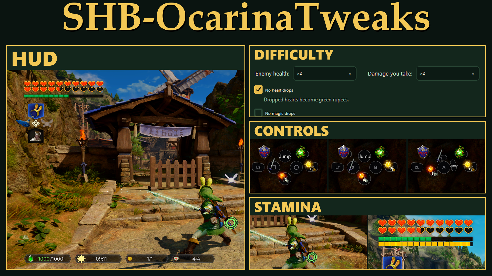
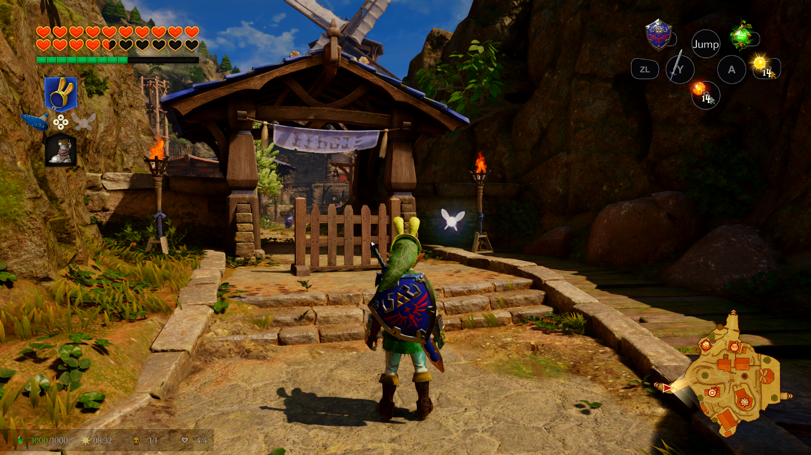
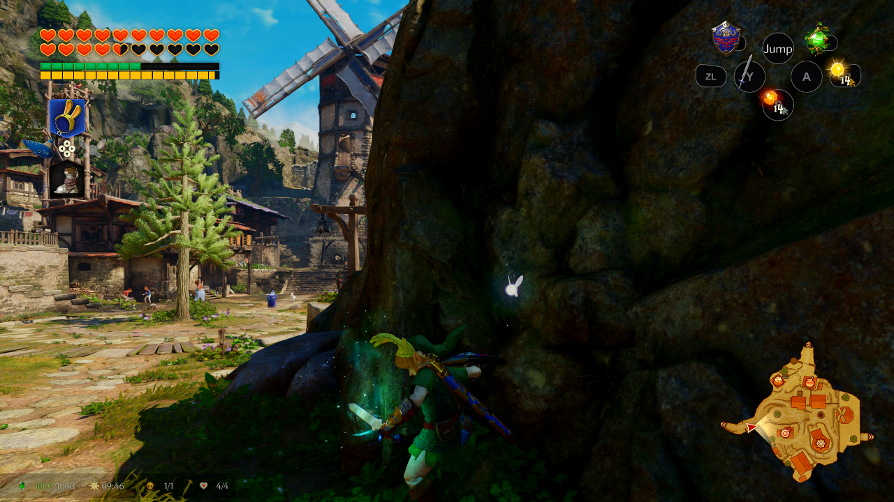

# Super Hero Boost



Gameplay module for the console remake of *Ocarina of Time* (update **v131072**) and its cross-platform
configuration app, **SHB-OcarinaTweaks**. The mod adds stamina, difficulty scaling, an extended HUD, a full button
remap, extra item buttons, quick select and more, all configurable without recompiling anything. The app patches the
prebuilt module and copies the files the game needs. The module, the HUD, the textures and the app are original
work: no third-party mod is bundled or downloaded.

Current release: **0.10.0**. **A new app**: SHB-OcarinaTweaks is a Rust program now, one executable with the
window and the command line, that carries the mod inside it and no longer needs Python (the Python one stays in the
repository as `app-legacy/`). The **controls** grew: a long press on **L and R** too, a **wait / no wait** choice per
held button (the **D-pad right** is not one of them: a tap always calls Navi and the hold is the role, so its row says
so instead of offering a switch), **shortcut roles** that can sit on two buttons, and the game's actions that no
button has are listed. The **enemy health and damage taken multipliers go up to ×6** (×1, ×1.5, ×2, ×2.5, ×3, ×4, ×5,
×6), in both apps. The **HUD** hides the corner minimap and the interaction guide bar properly, and the **item HUD** is
its own option. Under the hood, durations are **real seconds** (they no longer assume 60 frames a second) and the
module **writes nothing into the save folder**. The module changed, so install 0.10.0 and **rebuild the game once** on
Longshot, Hookshot, ReLink or Rekarina.

0.9.3 gave **A, B, X and Y a second action when you hold them**, with no delay on the short
press, added a **Back** role (the game's own B, on the held B in the Triggers table), made the toggled sprint let go
when you stop and stop throwing the objects you lift, fixes the manual shield throwing lifted jars and installs the
PlayStation prompts in the whole game, not only in the menu. 0.9.2 counts the **chests that hold a heart piece**
in the area counter. 0.9.1 made the **D-pad right** (Navi's arrow) a button for its **long press** (Armory, item
selector...), let the **item selector** sit on any button next to Item 2, added the **Triggers** control preset (used
by the Recommended profiles), brought back the sprint speed in the app, new drop-down lists, **Recompile** and
**Reinstall and recompile** buttons, and fixes for merged mods and the prompts on Rekarina.

0.9.0 added **Rekarina** as a target, a **button remap** where every button gets the role you choose (including
L3 / R3, a shield button and an **Armory** to change sword and shield), two HUD layouts with size sliders, the
**Switch GameCube** preset, enemy aggression options and a new app that is now called **SHB-OcarinaTweaks**.

## Screenshots

| | |
|---|---|
|  |  |
| Wide HUD: the four native-style plates | Simple HUD: one translucent bar (Plain: no bar) |
|  |  |
| Stamina as a ring around Link | Stamina as a segmented bar under the magic gauge |
|  |  |
| Controls with the PlayStation button art | Controls with the Xbox button art |

The app, in English: [Presets](docs/capturas/app-en-presets.png), [Gameplay](docs/capturas/app-en-gameplay.png),
[Difficulty](docs/capturas/app-en-difficulty.png), [Controls](docs/capturas/app-en-controls.png),
[HUD](docs/capturas/app-en-hud.png) and [Install](docs/capturas/app-en-install.png).

## What's new in 0.10.0

Everything since 0.9.3. Install 0.10.0 and **rebuild the game once** on Longshot, Hookshot, ReLink or Rekarina: the
module changed (its configuration block grew to 0x68 bytes).

**A new app, in Rust**

- **One executable.** `SHB-OcarinaTweaks.exe` is the whole app: started with no arguments it opens the window, with a
  command it is the command line (`install`, `uninstall`, `show`, `patch`, `lang`, `game`, `rebuild`, `play`,
  `update`). It needs no Python and no Tk, it carries the mod's files inside (27 MB), and it opens no terminal window
  behind it. A folder beside the program, or `SHB_PAYLOAD`, still wins over what it carries.
- **The same app, byte for byte.** The pages, the profiles, the previews and the texts (six languages) are the Python
  app's, and an install writes the same files: the patched modules (56 of 56), the installed folders (16 of 16),
  the recompiled games and the Rekarina installs are compared against the Python app by `app/tools/parity_check.py`.
- **It rebuilds the game itself.** On Longshot, Hookshot and ReLink it finds the builder the launcher installed, tells
  the builder the game's DLSS / FSR / XeSS options and drives it with a progress bar and a Cancel; on Rekarina it runs
  Rekarina's own lift and compile and does the app's part (ExeFS, patch tables, seeds, hashes) in Rust. **Install**,
  **Recompile**, **Apply settings** and **Reinstall and recompile** are the same four actions as before.
- **A failed install leaves nothing behind.** If the install fails halfway, the game goes back to what it was. Every
  action — install, uninstall, recompile — ends in a window that says it worked, or that it failed and why.
- **Folders are checked once, not all the time.** The install page tells you at once if a folder is not an emulator,
  not a recompiled game or a Rekarina without its `setup/`, and the actions stay off until it is right; it looks
  again only when the folder changes or an action ends, so the window stays light.
- **Profiles apply when you pick them.** Clicking a profile card sets its options; what a profile does not decide (the
  stamina display, R3 target, L3 sprint, button style, layout, language, HUD sizes) stays yours.
- **The Python app is `app-legacy/`.** It keeps working and is what the Linux and macOS releases still are, until the
  Rust window has been run there. Both read the same settings file, so you can switch between them.

**Controls**

- **A long press on L and R too.** Every button that can be held now has a row: A, B, X, Y, L and R, plus the D-pad
  right. A hold can be Jump, Sword, Action, Center camera or Back.
- **No hold where the button acts held.** A button whose own role is the shield, target, sprint, the item selector, the
  armory or an item has no hold (those roles act while held or at once); the row says why and is greyed out. The D-pad
  right keeps its hold: its short press is Navi's call, not a role of ours.
- **Wait or no wait, per held button.** *Skip the tap action when held* decides how a press is told apart: on, the tap
  waits about a third of a second to know it is not a hold (every tap is a little late, and a hold never also fires
  the tap); off, the tap acts at once and a hold comes on top. The arrow waits by default (so a hold does not call
  Navi); the face buttons, L and R act at once, as they always did.
- **Shortcut roles may repeat.** Jump, Sword, the item selector, the Armory and Back can sit on two buttons (jump on X
  and on R, say). The HUD draws each on its first button. The Controls card also lists, in amber, the game's own
  actions that no button has (jump, sword, action, target), or says that all of them have one.
- **Back moved to the held X** in the **Action at the bottom** and **Triggers** tables (the held B is blocked there:
  B is the action or the item selector). Applying a preset clears the wait of the button it holds.
- **Button mapping off turns its whole card off.** The manual shield, the R3 target, the L3 sprint and the targeting
  assists went on working with the mapping off; they follow it now.
- **The item HUD is its own option.** *Custom item HUD* adds our B, L, R and ZR item buttons and lets items 1-3 sit on
  remapped buttons. Off, the rest of the remap still works, a button with an item role keeps the game's own press, and
  your item HUD and the game's item logic stay untouched.

**HUD**

- **Hiding the corner minimap works.** The option used to zero the scale of the map's panes, and the map screen draws
  with the same panes: it opened with no map. The corner map is moved out of the screen while you play and put back
  when a menu covers the game.
- **The interaction guide bar is hidden** while the button-mapping HUD is on (its container moves off screen; nothing
  of its scale or transparency is written).
- **The simple and plain rows pack.** Each counter follows its own switch and the visible ones pack from the left; the
  soft bar is sized from what is drawn, and every icon sits right before its number (a long clock no longer ran past
  the bar, a short rupee count no longer left its icon far away).

**Module**

- **Durations are real seconds.** Every duration used to be a number of frames at a fixed 1/60 s, which is only right
  at 60 fps: on a machine that runs the game faster or slower, stamina and the rest ticked off by that factor.
  The sprint drain, the action costs and the recharge (0.8 s idle, 1.8 s in combat, 2.5 s after exhaustion) last what
  they say whatever the frame rate (measured live: 24/s of refill at 41 and at 50 fps, where counting frames gave 16
  and 20). A long press is 0.3 s, and so are the target-switch hold, the pause before the ZR item goes back into the
  box, the item-set check after loading a save and the 5 s "in combat" window.
- **The clock is the console's own.** It reads the game's counter (`CNTPCT_EL0`) and its rate (`CNTFRQ_EL0`): no new
  import, no file, nothing to install. If a target reports an implausible frame time the mod falls back to 1/60 per
  frame, so it cannot end up worse than before.
- **No file is written into your save.** The module used to leave a `shbdebug.bin` diagnostic next to every save it
  touched, from the input hook, inside the game's own save-commit window. It exists only in a build made with
  `--debug-dump` now; the release module creates no files at all.
- **It checks what it reads from the game.** The HUD layout hook checks the layout before it copies anything (a layout
  that does not look like ours gets the engine's own config back), the save path is checked before it is read, and the
  button-swap lookup runs every fourth frame instead of every frame.
- **The ZR button keeps its item.** Using an item changed the number on another item's button; and an item used from a
  slot (the slingshot, the bow, a bomb) is no longer put away by the game right after the use: it stays until ZR or
  another slot takes the box.
- **The context prompt has one writer.** A second writer fought the first on the same pane (a "Talk" prompt came out
  with the wrong glyph); the prompt's keys follow the remap from one place.

**Not changed**

- At 60 fps the same thresholds, the same recharge and the same costs as before. The gameplay, the profiles and the
  configuration format are untouched: an existing setup keeps working, and a module older than this one simply leaves
  the new controls (hold on L and R, the wait bits) at zero.

## What's new in 0.9.3

Everything since 0.9.2. Install 0.9.3 and **rebuild the game once** on Longshot, Hookshot, ReLink or Rekarina: the
module changed.

**Controls**

- **Two actions on A, B, X and Y: tap and hold.** Every one of those four buttons has a second row in Controls, marked
  with a down arrow, for what it does when you **hold** it (about a third of a second). The short press acts **at
  once**, with no delay; when the hold fires, the short role lets go. Pick a hold role that does not mind the short one
  having happened (Back, Armory, the selector, the camera ...). It takes jump, sword, action, camera, sprint, shield,
  selector, armory and Back; not items or target. A preset only sets the hold rows it names (see Back below).
- **New role: Back (the game's B).** The game's own B: let go of a ledge, cancel, get off ... With the remap those
  actions went with the button that held Item 1. Back works on any button and in a hold, and it is not an item use: it
  acts while Link is busy with something else (hanging, climbing, swimming ...) or when the B slot holds no item, so
  it never fires an item by accident.
- **Back is in the presets that need it.** The **Triggers** and **Action at the bottom** tables (the first one is the
  base of Recommended, Recommended without beta enemies, Super Hero, Ultra Hero and Beta All) have no item on the B
  button, so **holding B** is now the Back role there. Choosing a preset sets only the hold rows it names: your other
  hold rows stay.

**Sprint (toggle)**

- **It lets go when you stop.** The toggled sprint now ends by itself when you stop moving (a toggle pressed standing
  still waits for your first step).
- **No more thrown objects.** The sprint pressed A for you, and that A threw the jar you had just lifted, again on every
  pickup while it stayed on. It no longer presses A while you lift or carry something; the sprint speed still applies,
  so you can run with the object.

**Fixes**

- **The manual shield threw lifted jars by itself.** With the manual shield on, the module cleared two of the player's
  guard flags every frame, and while Link carried something that made the game throw the object a moment after the
  lift (found live in the emulator: with the option off the jar stayed in his hands). It leaves those flags alone
  while Link carries something.
- **The app opens with the stamina off.** The stamina page crashed with a `NameError` when the system was off.
- **PlayStation button prompts in the whole game.** Installing the PlayStation layout copied the controller picture of
  the menu but not the font that draws the button glyphs of every text and prompt, so the menu showed a DualSense and
  the rest of the game kept the Switch buttons. The app now installs both (the font is built with the payload).

## What's new in 0.9.2

A fix for the area counter of the HUD. Install 0.9.2 and **rebuild the game once** on Longshot, Hookshot, ReLink or
Rekarina: the module changed.

- **Heart pieces in chests count now.** The heart counter knew the pieces lying in the world and the rewards, but
  not the chests that hold one, so an area whose only piece was a chest read 0/0 even after you opened it (found in
  Zora's Domain). The ten chests with a heart piece (Gerudo Fortress and Valley, Graveyard, Dampe's race, Hyrule
  Field, the Market minigame, Zora's Domain) are in the total and count once opened.

## What's new in 0.9.1

Everything since 0.9.0. Install 0.9.1 and **rebuild the game once** on Longshot, Hookshot, ReLink or Rekarina: the
module changed.

**Controls**

- **D-pad right is a button too (long press).** A short press still calls **Navi**, as in the game. Holding the arrow
  does the role you give it: Jump, Sword, Center camera, Sprint, Shield, **Item selector** or **Armory**. The app lists
  it as the last row of Controls. It is not part of the control presets: picking one keeps the arrow's role.
- **The item selector goes on any button but the sticks, and no longer takes Item 2 away.** It has its own virtual
  button now, so Item 2 and the selector can be on the table at once (before, setting one dropped the other).
- **New control preset: Triggers.** Items on the triggers (R, ZL and ZR), the item selector on B, the shield on L,
  sprint on L3, target on R3. The profiles built on the tuned controls (**Recommended**, Recommended without beta
  enemies, **Super Hero**, **Ultra Hero** and **Beta All**) bring this table.
- **Armory on the held D-pad right in the profiles.** Every profile that has the pack's buttons (all but Manual Shield)
  puts the Armory on the arrow and takes it off any other button. The rest of your table stays yours.
- **Sprint ×1.25 in every profile.** (It was ×1.5 in the named profiles.)

**App**

- **Sprint speed is back in the Gameplay page.** The option had disappeared from the window; the module always had it.
- **New drop-down lists.** The selects open their own list: the wheel scrolls the list and never the page, a click
  outside only closes it, the arrows and Enter work, and it closes when the page scrolls under it. No more white edge.
- **Recompile and Reinstall and recompile** for Longshot, Hookshot, ReLink and Rekarina, shown only while the mod is in
  the game. *Recompile* only runs the builder: it copies and patches nothing, so what you did by hand stays. *Reinstall
  and recompile* uninstalls, copies everything again and builds.

**Rekarina**

- **Merged mods.** A mod merger puts every mod's ExeFS patches in one IPS; Rekarina's converter takes a patch file
  whole, so one record it cannot lift made it drop our hooks (`rekarina_patch_failed`). The app now moves the other
  mods' records to `exefs/<id>-other-mods.ips` before it converts, and says which record was rejected.
- **PlayStation / Xbox prompts, the song screen included.** The app no longer installs its own copy of the game's
  button font on Rekarina: a mod file for that font stopped Rekarina from switching the prompts while the game runs
  (the ocarina's six note buttons stayed on the Switch ones). Apply the settings once to remove it.

Known gaps: the D-pad right long press, the free selector and the Rekarina prompts were checked in the emulator and
in the logs, not yet on the three recompilations. The long-press delay is a fixed 20 HUD frames.

## What's new in 0.9.0

Everything since 0.8.0. Install 0.9.0 and **rebuild the game once** on Longshot, Hookshot, ReLink or Rekarina: the
module changed.

**Controls**

- **Button remap.** Every physical button (L, R, ZL, ZR, X, Y, A, B, L3 and R3) gets a role: Jump, Sword, Action,
  Target, Item B / L / R, the game's own item (ZR), Center camera, Sprint, Shield, Item selector, Armory or nothing
  (at most four item buttons; items never on L3 / R3, the selector only on L / R, Target only on ZL / ZR / L3 / R3).
  The old switches (manual shield, target on R3, L3 sprint, L mode) now come from the table. The app has a remap editor
  with a controller preview and an in-game HUD preview in the chosen button style and layout, and five control
  presets: **Classic**, **Action at the bottom**, **Manual shield**, **Souls (target on R3)** and **Switch GameCube**.
- **A remapped button does only its role, and only while you play.** Menus, the pause menu, dialogues and shops get
  the real buttons, so A / B still confirm and go back; the remap stays on through hit stops, so a button never lets its
  native action through. The context prompt follows the button that holds the Action role.
- **Armory.** A button with the Armory role opens the game's own item drawer while it is held, with the swords and
  shields Link owns and can use at his age; the stick or D-pad moves the cursor and letting go equips it. It is a
  implementation of the Armory idea credited below. A button with the **Shield** role shows the
  equipped shield on the HUD.
- **Quick mask** goes back from the Lens of Truth to the last mask you wore.
- **Item buttons fixed.** The ZR item follows the game's item set (Child / Adult), so it no longer shows a stale icon;
  the Deku stick stays in hand; the ZR item can go on an empty slot; an item is no longer dropped right after you assign
  it. The pause menu is detected steadily: assigned items are not undone any more, and the L3 toggle sprint and the
  stamina lock no longer touch the input under a menu.
- **L3 sprint on Rekarina.** The input handlers read only the samples the console call returned (Rekarina returns one),
  so the sprint starts, stops and toggles as it does in the emulator.

**HUD**

- **Three layouts:** **Wide** (the native plates), **Simple** (the four counters in one row on a soft translucent bar)
  and **Plain** (the same row with no bar). The old Minimal layout is gone; a saved Minimal becomes Plain.
- **Size sliders** (50-200 %) for the controls cluster and for the counter row. Each keeps its screen corner (controls
  top right, counters bottom left); the CLI has `--hud-ctrl-scale` and `--hud-count-scale`.
- **Widescreen.** The HUD buttons with their labels, and the lower counters with their icons and plates, are grouped so
  they move together with Longshot's "Screen's edges" setting (HaseoSora).
- **Switch GameCube preset** with its button art and controller diagram (HaseoSora).
- **Collectibles counter** copies the save's key set, counts the heart pieces placed in the world and looks GameData
  up by hash, so it stays right with romfs mods that shift the tables.
- **PlayStation / Xbox prompts.** The PlayStation button font fits the loader's size budget and the game-wide layout
  skips the External font that does not fit. The pause menu's assign legend has no backing plate and sits higher.

**Difficulty and enemies**

- **The multipliers go up to ×6:** enemy health and damage taken are ×1, ×1.5, ×2, ×2.5, ×3, ×4, ×5 or ×6, chosen in
  either app (the module does the maths from the percentage, so a step is a label).
- **Aggression options:** *Alert radius* (how far an enemy that spots you alerts the others) and an *Aggression*
  level: Normal, Aggressive or Maximum (shorter shared pause, longer chases, fighting off screen). Bosses are not
  changed, and the options combine with the speed multipliers instead of replacing them.
- **Duplicated enemies:** wall and ceiling enemies (Skullwalltula, perched Keese, Jabu-Jabu's Tailpasaran) and stage
  pieces are no longer cloned, so nothing hangs in the air or sits inside a wall.
- **Enemy health is scaled exactly once**, however many enemies are loaded and whatever the game resets.
- **Profiles.** **Recommended** is now the author's own setup (x2 health and damage, no heart drops, hardcore
  stamina, beta enemy mods with aggression, the simple HUD, the manual shield with the targeting assists, R3 lock-on and
  the L3 sprint toggle, sprint x1.5) and the other profiles follow it; *Recommended (no beta enemies)* drops the enemy
  mods.

**Rekarina**

- **Rekarina supported.** Rekarina is the Switch 2 static recompilation that loads ExeFS modules and takes romfs mods.
  The app adds the mod's module as `subsdk9` to the lift, compiles it with Rekarina's own `gen.py` and `build_game.py`,
  converts the mod's IPS with its `tools/exefs_patches.py`, installs the romfs as `mods/zz-Super-Hero-Boost/romfs`,
  puts the mod first in `mods_order` and replaces `Rekarina.exe` with the new build (backed up). Nothing in the Rekarina
  folder is edited.
- **Settings without a rebuild.** Applying a profile patches `exefs/subsdk9` and the expected SHA-256 stored in
  `Rekarina.exe`, so changing options takes seconds; the 10-20 minute rebuild is only needed the first time or when the
  module changes. Uninstall restores the exe, the module, the old mod code, the status files and the mod order.
- **Old merged code disabled safely.** A merged mod folder (for example the Mod Merger's `0-M`) that still carries an old
  `subsdk9` / IPS is moved aside (backed up), so Rekarina stops marking the whole mod as PLUGIN and its romfs loads.
- **Module data without pointers.** The build fails on any pointer table in the module's data, the cause of crashes
  when the module sits at Rekarina's address; the Armory skips the game call that truncates module pointers.

**App**

- **Renamed to SHB-OcarinaTweaks** (the executable, the window, the settings file and the release files:
  `SHB-OcarinaTweaks.exe`, `SHB-OcarinaTweaks-linux`, `SHB-OcarinaTweaks-macos.dmg`). Settings saved under the old name
  are still read, and the updater still recognises the old release file names.
- **New interface:** CustomTkinter theme, a **Presets** page, target cards, inline help and a Help section, one
  **Controls** section with the button mapping, a stamina preview, drop-down lists that no longer click through, and
  the two HUD size sliders.

## Features

### Gameplay

- **Complete profiles**: **Recommended** (the author's setup: ×2 enemy health and damage, hardcore stamina, the
  beta enemy mods, the simple HUD, the manual shield with the targeting and the R3/L3 controls), Recommended without
  the beta enemies, Souls controls, Souls controls + Hero Mode, Base, Manual Shield, Hero Mode, Hero + Stamina, Hero
  Explorer, Super Hero, Ultra Hero, Survival, World changes and the two beta combinations (enemies only, everything).
  They set difficulty, stamina, the HUD, the world changes, the manual shield, the targeting and the enemy mods in
  one step; changing any option afterwards switches the profile to **Custom**. The Souls profiles also turn on the
  stamina bar and the lock-on with R3.
- **Stamina** with four styles: hardcore (everything costs), combat only, sprint only and advanced (choose which
  actions cost). Includes exhaustion and regeneration, and costs for rolling, jumping, attacking, shooting,
  sprinting and blocking with the shield.
- **Stamina display**: a ring next to the player or a segmented bar under the magic gauge (yellow, red while
  recharging; grows with your hearts).
- **Sprint speed** configurable (×1.25 in the profiles and in Custom).
- **Enemy health** and **damage taken** multipliers (×1 to ×6, in steps of ×0.5 / ×1).
- **No heart drops**: hearts dropped by enemies become green rupees instead.
- **Always-visible clock and rupee counter**, with the game's native look and 12/24-hour format.
- **Songbook autoplay**: selecting a learned song in the native songbook (ZL) makes the hero play it and trigger
  its effect. Learned songs only; not the Scarecrow's Song.
- **Area collectibles counter**: a native-style plate below the clock with the Gold Skulltulas and heart pieces of
  the current area (for example `SKULL 3/8  COR 0/2`). The Skulltulas are read from the save's persistent key set, so
  the count no longer resets when you leave and re-enter an area; heart pieces without a map anchor (some
  chests/minigames) are not counted yet.
- **Three HUD layouts**: **Wide** (the four native-style plates), **Simple** (the four counters in one row on a soft
  translucent bar) and **Plain** (the same row with no bar), with sliders (50-200 %) for the size of the controls
  cluster and of the counter row. The area heart counter can also show on the Minus map.
- **World changes**: reorders the three Great Fairy magic rewards (Hyrule Castle child gives **Nayru's Love**, Death
  Mountain Crater the **magic spin attack** and Desert Colossus **double magic**) and allows placing **Farore's Wind**
  warp points outside dungeons. Each fountain keeps her own model and dialogue; the Din fairy's overview still
  describes the original order.
- **Button remap and own item buttons** (`buttonMapping`):
  - **Roles for every button:** L, R, ZL, ZR, X, Y, A, B, L3 and R3 can each be Jump, Sword, Action, Target, an item
    button (B / L / R), the game's own item (ZR), Center camera, Sprint, Shield, Item selector, Armory or nothing. The
    HUD, the pause menu legend and the assign buttons follow the table. Five control presets (Classic, Action at the
    bottom, Manual shield, Souls, Switch GameCube) fill it in one click.
  - **B, L, R and ZR** item buttons on the HUD, assignable from the **Items** tab of the pause menu, with the quantity
    of consumables and the exact content of a bottle.
  - **Switch / PlayStation / Xbox** button pictures for the mapping HUD, and **button positions**: Nintendo, A and B
    swapped, Xbox (A/B and X/Y swapped) or Switch GameCube, to match the recompilers' button layout. Only where the
    buttons are drawn changes; the game's logical buttons stay the same.
  - **Extended** layout (B, L, R, ZR, X, Y, A and the sword) or **simple** layout (only the assignable buttons, with
    B centred and L / R / ZR repositioned so there are no gaps).
  - **L button modes**: item or the game's item selector.
  - **Jump/B swap**: if the game's System > Options **Swap Jump Controls** is on, the B item slot moves to **X**
    automatically (input, icon position and menu legend); B keeps its native jump.
  - **Armory**: hold a button with that role to open the game's item drawer with your swords and shields and equip
    one; a **Shield** role shows the equipped shield on the HUD.
- **Game button prompts** (HUD section, optional): replace the game's own prompts, font and controller picture with
  PlayStation or Xbox ones, downloaded once (~70 MB) from GameBanana and cached. None by default; Longshot and
  ReLink already include their own.

### Quick select

- **D-pad Down**: switch between the **Iron Boots** and **Hover Boots** without opening the pause menu. From the
  default boots it picks the first of the two you own.
- **D-pad Up**: switch between the **Lens of Truth** and the **mask** you were wearing.
- Only items in your inventory are used. The change is applied immediately through the game's own equip request,
  not just written to the save.
- A short tap keeps the game's normal D-pad behaviour.
- The named profiles (including **Recommended**) turn it on; each selector can still be disabled in the app's
  **Quick select** section. It writes the game's equipment live, so keep a save backup.

### Manual shield

- **ZL follows the game's Targeting Type option** (System > Options): in **Hold Target**, hold ZL to target; in
  **Toggle Target**, press ZL to toggle.
- **L raises the shield only while targeting.** With no target it keeps its default game function; while targeting
  or guarding (including shield-hit reactions and hit-stop) it is reserved until it is released, so the item
  selector never opens in the middle of a guard. "Targeting" is the game's own lock (and, in Hold Target, the held
  target button); standing near enemies is not.
- **R3** cancels targeting, unless the target-on-R3 swap is enabled.
- Optional: it is off by default and can be enabled in the app's **Controls** section.
- The target button always reaches the game as you press it; the game's Hold/Toggle option decides.
- Independent of the stamina system: the stamina config still applies its own held/hit costs when stamina is on.

### Controls

- **Target with R3**: swaps ZL and R3, so R3 holds or toggles the target camera and ZL resets it. Recommended with
  the game's **Hold** targeting type.
- **Hold L3** to sprint: uses the game's sprint flag and animation, without pressing A and without rolling.
- **Switch target with the target button**: while locked on, tap the target button (ZL, or R3 with the swap) to move
  the lock to the enemy with the red marker; hold it to drop the target. With no target it locks on as usual.
  Needs Targeting Type on **Toggle**.
- **Next target when it dies**: when the locked enemy dies, the next one is locked on automatically (nothing happens
  when there is none, or when you dropped the target yourself). Needs Targeting Type on **Toggle**.
- **D-pad right, long press**: a short press still calls Navi; holding it does the role you choose (Armory, item
  selector, Jump, Sword, camera, sprint or shield). The Armory is on it in the profiles. The item selector has its own
  button in the table, so it can sit on any button next to Item 2.
- The manual shield and button mapping are described above and below. Target with R3 and L3 sprint are personal
  preferences (only the Souls profiles turn R3 on); the switch and next target come with the combat profiles. With
  the button remap they are the Target, Sprint and Shield roles of the table.

### Configuration app

- **SHB-OcarinaTweaks** (`app/`, Rust): the window and the command line in one executable, for Windows. It carries the
  mod's files, so nothing else has to be installed. The legacy Python app (`app-legacy/`, Python 3.10+ with Tkinter and
  CustomTkinter) is the same app for Linux and macOS, and runs from the sources anywhere.
- Profiles and control presets, per-section settings (Install, Presets, Gameplay, Difficulty, Controls, HUD,
  Miscellaneous), install and uninstall into the emulator's mod folder, with a remap editor in **Controls**.
- **Three targets**: an emulator, a recompiled game (Longshot, Hookshot, ReLink) and Rekarina. For the last two the
  app also runs the rebuild, with a progress bar, and undoes a failed install.
- **Play** opens the emulator (or the recompiled game's launcher, or Rekarina) directly.
- On Longshot, Hookshot and ReLink, a red **Requires rebuild** tag marks the feature switches whose change needs the
  builder; their sub-options do not.
- **Quick select**: boots and mask switching from the D-pad.
- Checks GitHub Releases on startup and offers to download a newer version; on Windows it replaces itself and
  restarts.
- Translations in Spanish, English, Portuguese, French, German and Italian.
- Command-line mode to install the same configuration without opening the window (see below).

### Beta

These options are **experimental**: they install extra romfs files. They can break puzzles, quests or performance.
Back up your save and test one at a time. The two beta profiles (*Beta: duplicated + fast enemies* and *Beta:
everything*) turn them on together with the rest of the configuration.

- **Enemy duplication (Option A)**: clones generic enemy placements in the map data and doubles field auto-spawn
  counts. Bosses, minibosses and scripted enemies are excluded.
- **Enemy speed**: four independent components (movement, animation playback, attack cadence and
  projectile speed), each with eleven multipliers from x0.5 to x6 (plus off). Movement scales
  every base and attack speed together, so enemies do not slide or overshoot.
  Attack cadence scales the interval tables and the action timeouts; projectiles are separate. Some
  enemies or attacks may not change or may desync.
- **Enemy aggression**: an alert radius multiplier (how far a spotting enemy alerts the others) and an aggression level
  (Normal / Aggressive / Maximum), patched into the enemy data at install time. They combine with the speed options;
  bosses are not changed.

## Usage

1. **Requirements**: the game on update **v131072** and an emulator that loads mods from its
   `user/load/0400486024DEC000` folder (or the path you have configured). Back up your save before installing.
2. Open **SHB-OcarinaTweaks** (on Linux and macOS, the legacy app; or run `python app-legacy/main.py` from source).
3. Pick a profile or adjust the sections one by one.
4. Select the emulator folder. The app finds the mods folder, including a custom `load_directory` from
   `qt-config.ini`.
5. Press **Install**. The app creates the `zz-Super-Hero-Boost` folder with the module, the button textures and the
   optional romfs files, and patches the selected configuration.
6. Close the game before uninstalling. On Windows the app closes a running game before installing and during
   a rebuild (it cannot replace a running executable); save your progress first.

To remove the mod, press **Uninstall** in the app or delete the `zz-Super-Hero-Boost` folder.

Prebuilt binaries are published on the [Releases](https://github.com/kuribox/OOT-SuperHeroBoostMod/releases) page;
you can also build the app from source with the steps below.

| Your system | Download |
|---|---|
| Windows | `SHB-OcarinaTweaks.exe` (the current app, Rust) — `SHB-OcarinaTweaks-legacy.exe` is the Python one |
| Linux (x86_64) | `SHB-OcarinaTweaks-linux` (the legacy app) — `chmod +x SHB-OcarinaTweaks-linux` after downloading |
| macOS (Apple Silicon) | `SHB-OcarinaTweaks-macos.dmg` (the legacy app) — open it and drag the app to Applications (not signed: right-click > Open the first time) |
| Emulator, no app | `SuperHeroBoost-<version>-presets.zip` — ready-to-install mod folders |

The Windows builds are the only ones with a `.exe` extension; the Linux one is a plain executable named with
`-linux` and the macOS one is a `.dmg` disk image. The Rust app has only been run on Windows so far; Linux and macOS
get the legacy app until that changes.

### Longshot, Hookshot and ReLink

Hookshot, Longshot and ReLink are static recompilations, not emulators: they translate the game to native code and
ignore `exefs` mods by design. The romfs files work from `<game>/mods/zz-Super-Hero-Boost/romfs`, but the module (HUD,
stamina, item buttons, collectible counter) has to be built into the game.

- **Longshot: supported and tested.** The app's **Longshot** target patches the game's `main`, copies the module to
  `.longshot_exefs`, installs the chosen romfs options and runs the builder's update with a progress bar. The first
  build takes 25-45 minutes; later code changes are incremental (~5 minutes) and profile/romfs-only changes need no
  rebuild. It is reversible with **Uninstall**; rebuild once whenever the module changes.
- **Hookshot: expected to work, not tested yet.** It ships the same builder and the same
  `nx2/make_game.py --update`; point the app's target (or `tools/install_longshot.py --builder`) at its
  `HookshotBuilder` folder. The procedure is otherwise identical.
- **ReLink: supported.** Its game is `bin/relink-game`, its exefs `.relink_exefs` and its builder
  `%LOCALAPPDATA%\ReLink\versions\<version>\ReLink` (or the Linux/macOS data folder). The same install, rebuild
  and uninstall steps apply. Tested with a full ReLink 0.7.9 build: stamina, manual shield, button mapping and
  controls work after rebuilding with the current module.
- **Rekarina: supported (new in 0.9.0).** Point the target at Rekarina's game folder (the one with `Rekarina.exe`,
  `rekarina.ini` and `exefs/main`); the app finds `setup/<version>` beside it and drives Rekarina's tools. It never
  edits Rekarina: the lift runs `gen.py --modules main,subsdk0,sdk,subsdk9`, the compile runs `build_game.py`, and
  the ExeFS patches go through `tools/exefs_patches.py`. Two runners in the work folder add the compile flags and the
  hook resume points as extra `main` seeds (Rekarina dispatches only to function starts). The module is built for
  Rekarina's layout (`main+0x5200000`) with a synthetic `eh_frame_hdr` seed table and a minimal dynamic symbol table
  (its loader requires one). The mod's IPS stays in `mods/zz-Super-Hero-Boost/exefs` so its runtime switches the
  generated code set on. The first build takes 10-20 minutes and ~6 GB in `game/.shb-rekarina`; later settings
  changes take seconds. Uninstall restores the exe and every file the install touched.
- The app finds the builder of the game's own flavor on Windows, Linux and macOS, and shows whether it was detected
  or chosen by hand. `LONGSHOT_BUILDER`, `HOOKSHOT_BUILDER` and `RELINK_BUILDER` override it.

See [docs/LONGSHOT.md](docs/LONGSHOT.md) for the details.

### Button mapping controls

- In the pause menu's **Items** tab, with an item highlighted: **X** assigns it to **B**, **L** to **L**, **R** to
  **R** and **A** to the game's **ZR** box.
- Pressing the same button again unassigns it; if the item was already in another slot, they are swapped.
- If L is in **selector** mode, L cannot be assigned and its button is hidden from the HUD and from the legend.
- In **selector** mode, L opens the game's item selector.
- With the button remap, the assign buttons follow the roles: an item on a slot is assigned with that slot's own button
  when the Items tab allows it, or with a free one of X / Y / L / R, and the legend shows which.

### Command line

The same executable is the command line when it is given a command:

```bash
SHB-OcarinaTweaks profiles                                       # the profile keys
SHB-OcarinaTweaks install --emu "EMULATOR_PATH" --profile recommended
SHB-OcarinaTweaks install --emu "EMULATOR_PATH" --profile hero-explorer --button-style switch --bm-simple
SHB-OcarinaTweaks install --emu "EMULATOR_PATH" --profile recommended --bm-l selector
SHB-OcarinaTweaks install --emu "EMULATOR_PATH" --profile recommended --quick-boots --quick-mask
SHB-OcarinaTweaks install --emu "EMULATOR_PATH" --profile base --hud-mode plain --hide-minimap
SHB-OcarinaTweaks install --emu "EMULATOR_PATH" --profile recommended --controls triggers --bm-layout xbox
SHB-OcarinaTweaks rebuild --game "F:\Switch2\Longshot\rc" --profile recommended        # install and compile
SHB-OcarinaTweaks rebuild --game "F:\Switch2\rekarina" --mode settings --profile souls  # settings only, no compiler
SHB-OcarinaTweaks uninstall --emu "EMULATOR_PATH"
SHB-OcarinaTweaks --help                                         # every command and option
```

`--profile` applies a complete profile; individual flags override it, and `--settings <file>` starts from the JSON the
window saves. `rebuild` takes `--mode install|recompile|settings|reinstall` and `--builder <folder>`; whether the folder
is a recompiled game or Rekarina is decided from what is in it. The command line prints to the terminal that ran it;
from `cmd` or PowerShell the program does not hold the prompt, so use `start /wait` to wait for it. The legacy app takes
the same options as `python app-legacy/main.py --cli --emu "EMULATOR_PATH" --profile recommended` (`--list-profiles`
lists them).

The Great Fairy mod rewrites event flows with the `evfl` library (`pip install evfl`); if it is not installed,
`make_release.py` warns and keeps the previously generated files.

## Building

The app does not compile the mod: it uses the payload already staged in `app/payload`, which both apps share.
Regenerating it requires the game dump, LLVM (`clang`, `lld`, `llvm-objcopy`, `llvm-size`, `llvm-nm`) and the
development dependencies listed in [docs/GUIA-DESARROLLO.md](docs/GUIA-DESARROLLO.md).

```bash
python tools/build_core.py --features stamina,songbook,button_mapping --slots --compat --base 0x4F80000
python tools/make_release.py       # module + button textures + optional romfs files -> app/payload
python tools/build_app.py          # the current app (Rust): release/SHB-OcarinaTweaks[.exe]
python tools/build_app.py --legacy # the legacy app (Python): release/SHB-OcarinaTweaks-legacy.exe + the presets zip
python tools/build_app.py --all    # both
```

The repository keeps two apps side by side:

| Folder | App | Built with |
|---|---|---|
| `app/` | the current one, **Rust**: a cargo workspace (`crates/shb-core`, `shb-cli`, `shb-gui`) and its `tools/` | `cargo build --release -p shb-cli` inside `app/` (Rust from [rustup.rs](https://rustup.rs)); `tools/build_app.py` runs it and copies the executable to `release/` |
| `app-legacy/` | the first one, **Python** (Tkinter / CustomTkinter) | PyInstaller (`pip install pyinstaller zstandard customtkinter`); it does not cross-compile: run it on each target OS |

`app/payload` is the one folder both use (the Rust build embeds it, PyInstaller bundles it) and it is never committed.
`cargo test` in `app/` runs the tests; `python app/tools/parity_check.py --app app-legacy --payload app/payload --mode
all` compares the Rust app with the Python one byte by byte, and `python app/tools/gen_i18n.py --check` checks that the
window's texts match `app-legacy/i18n.py`. `build_app.py --legacy` also writes
`release/SuperHeroBoost-<version>-presets.zip`, one zip with every profile as a ready-to-install mod folder (no
executables), for the GameBanana Mods upload. See the development guide for details.

## Documentation

- [docs/GUIA-DESARROLLO.md](docs/GUIA-DESARROLLO.md): architecture, hooks, HUD, configuration and compilation.
- [docs/APP.md](docs/APP.md): app, profiles and options.
- [app/README.md](app/README.md): the current app (Rust): crates, build, tests, how it matches the legacy one.
- [docs/RELEASE-0.10.0.md](docs/RELEASE-0.10.0.md): the 0.10.0 release notes.
- [docs/BUTTON-MAPPING.md](docs/BUTTON-MAPPING.md): button mapping design.
- [docs/RE-NOTES.md](docs/RE-NOTES.md): reverse-engineering notes.
- [docs/LONGSHOT.md](docs/LONGSHOT.md): installing the mod in Hookshot and Longshot (static recompilations).
- [docs/AUDIT.md](docs/AUDIT.md): code and third-party material audit.

## Credits

Module, HUD, stamina system, button mapping (with its textures) and the apps (Rust and legacy Python): original work by Kuribox.

Thanks to:

- [HaseoSora](https://github.com/HaseoSora) for the **Switch GameCube** preset with its button artwork and
  controller diagram, and for grouping the HUD panes so the clusters keep their alignment under widescreen
  ("screen's edges") layouts.
- [PixelSage / Hyrule Armory](https://gamebanana.com/mods/740938) for the original **Armory**: the sword and shield
  quick select that this mod's Armory role reimplements (its own code and drawer hooks, nothing bundled).
- [DoctorTwitch / Dualsense/XBOX/Steamdeck UI](https://gamebanana.com/mods/737074) for the PlayStation and Xbox
  button layouts that the app can download on request (the optional *Game button prompts*). They are not bundled:
  the app fetches them from GameBanana the first time you choose them.
- [Kabosune / oot-remake-modding](https://github.com/Kabosune/oot-remake-modding) for the modding documentation
  and help.
- [platinumagpie / oot-remake-devtool](https://github.com/platinumagpie/oot-remake-devtool) for the development tools
  used during research and testing.

These projects are development references and tools; their code is not bundled with this mod.

## AI assistance

AI assistants were used for parts of the coding, reverse engineering and testing: **Anthropic Claude**
(https://www.anthropic.com) and **DeepSeek** (https://www.deepseek.com). I orchestrated the work, tested the results
and adjusted them until they worked.

## License

Licensed under the **MIT License**. See [LICENSE](LICENSE).

You can use, modify, redistribute and build on this project, including commercially, as long as you keep the
copyright and license notices.
