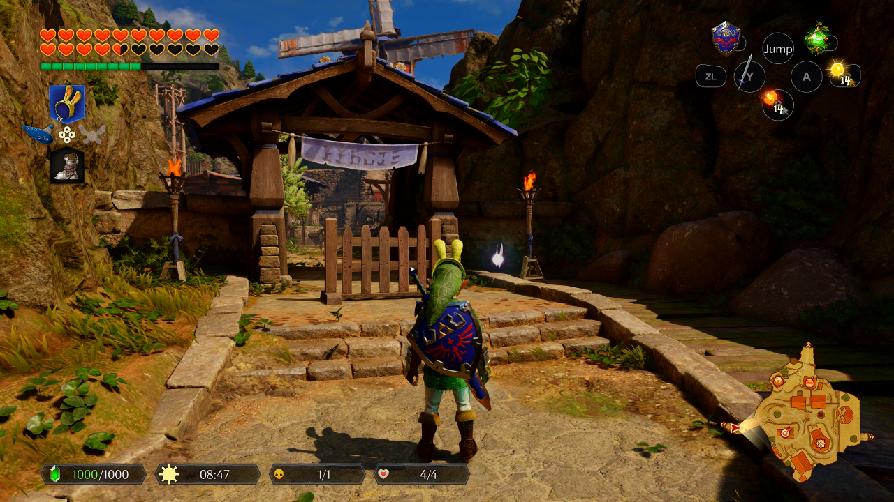
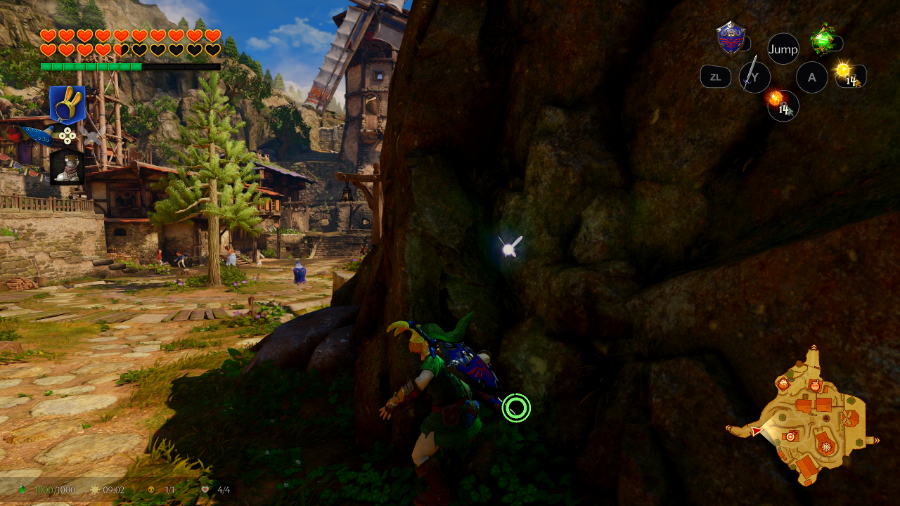
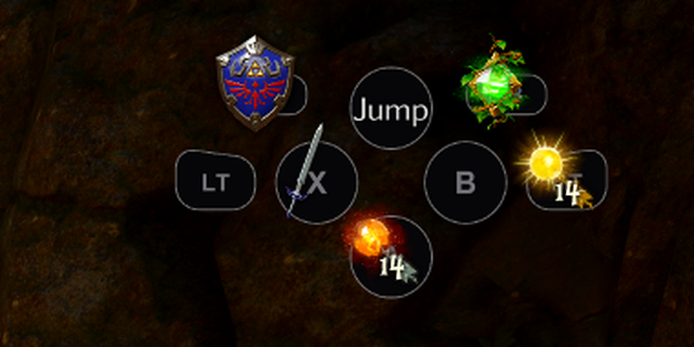

# Super Hero Boost


Gameplay module for the console remake of *Ocarina of Time* (update **v131072**) and its cross-platform
configuration app, **SHB-OcarinaTweaks**. The mod adds stamina, difficulty scaling, an extended HUD, a full button
remap, extra item buttons, quick select and more, all configurable without recompiling anything. The app patches the
prebuilt module and copies the files the game needs. The module, the HUD, the textures and the app are original
work: no third-party mod is bundled or downloaded.

Current release: **0.9.0**. It adds **Rekarina** as a target, a **button remap** where every button gets the role you
choose (including L3 / R3, a shield button and an **Armory** to change sword and shield), two HUD layouts with size
sliders, the **Switch GameCube** preset, enemy aggression options and a new app that is now called
**SHB-OcarinaTweaks**.

## Screenshots

| | |
|---|---|
|  |  |
| Wide HUD: the four native-style plates | Simple HUD: one translucent bar (Plain: no bar) |
|  |  |
| Stamina as a ring around Link | Stamina as a segmented bar under the magic gauge |
|  |  |
| Controls with the PlayStation button art | Controls with the Xbox button art |

The app, in English: [Presets](docs/capturas/app-en-presets.png), [Gameplay](docs/capturas/app-en-gameplay.png),
[Difficulty](docs/capturas/app-en-difficulty.png), [Controls](docs/capturas/app-en-controls.png),
[HUD](docs/capturas/app-en-hud.png) and [Install](docs/capturas/app-en-install.png).

## What's new in 0.9.0

Everything since 0.8.0. Install 0.9.0 and **rebuild the game once** on Longshot, Hookshot, ReLink or Rekarina: the
module changed.

**Controls**

- **Button remap.** Every physical button (L, R, ZL, ZR, X, Y, A, B, L3 and R3) gets a role: Jump, Sword, Action,
  Target, Item B / L / R, the game's own item (ZR), Center camera, Sprint, Shield, Item selector, Armory or nothing
  (at most four item buttons; items never on L3 / R3, the selector only on L / R, Target only on ZL / ZR / L3 / R3).
  The old switches (manual shield, target on R3, L3 sprint, L mode) now come from the table. The app has a remap editor
  with a controller preview and an in-game HUD preview in the chosen button style and layout, and five control
  presets: **Classic**, **Action at the bottom**, **Manual shield**, **Souls (target on R3)** and **Switch GameCube**.
- **A remapped button does only its role, and only while you play.** Menus, the pause menu, dialogues and shops get
  the real buttons, so A / B still confirm and go back; the remap stays on through hit stops, so a button never lets its
  native action through. The context prompt follows the button that holds the Action role.
- **Armory.** A button with the Armory role opens the game's own item drawer while it is held, with the swords and
  shields Link owns and can use at his age; the stick or D-pad moves the cursor and letting go equips it. It is a
  reimplementation of what the community mod Hyrule Armory Sync does. A button with the **Shield** role shows the
  equipped shield on the HUD.
- **Quick mask** goes back from the Lens of Truth to the last mask you wore.
- **Item buttons fixed.** The ZR item follows the game's item set (Child / Adult), so it no longer shows a stale icon;
  the Deku stick stays in hand; the ZR item can go on an empty slot; an item is no longer dropped right after you assign
  it. The pause menu is detected steadily: assigned items are not undone any more, and the L3 toggle sprint and the
  stamina lock no longer touch the input under a menu.
- **L3 sprint on Rekarina.** The input handlers read only the samples the console call returned (Rekarina returns one),
  so the sprint starts, stops and toggles as it does in the emulator.

**HUD**

- **Three layouts:** **Wide** (the native plates), **Simple** (the four counters in one row on a soft translucent bar)
  and **Plain** (the same row with no bar). The old Minimal layout is gone; a saved Minimal becomes Plain.
- **Size sliders** (50-200 %) for the controls cluster and for the counter row. Each keeps its screen corner (controls
  top right, counters bottom left); the CLI has `--hud-ctrl-scale` and `--hud-count-scale`.
- **Widescreen.** The HUD buttons with their labels, and the lower counters with their icons and plates, are grouped so
  they move together with Longshot's "Screen's edges" setting (HaseoSora).
- **Switch GameCube preset** with its button art and controller diagram (HaseoSora).
- **Collectibles counter** copies the save's key set, counts the heart pieces placed in the world and looks GameData
  up by hash, so it stays right with romfs mods that shift the tables.
- **PlayStation / Xbox prompts.** The PlayStation button font fits the loader's size budget and the game-wide layout
  skips the External font that does not fit. The pause menu's assign legend has no backing plate and sits higher.

**Difficulty and enemies**

- **Aggression options:** *Alert radius* (how far an enemy that spots you alerts the others) and an *Aggression*
  level: Normal, Aggressive or Maximum (shorter shared pause, longer chases, fighting off screen). Bosses are not
  changed, and the options combine with the speed multipliers instead of replacing them.
- **Duplicated enemies:** wall and ceiling enemies (Skullwalltula, perched Keese, Jabu-Jabu's Tailpasaran) and stage
  pieces are no longer cloned, so nothing hangs in the air or sits inside a wall.
- **Enemy health is scaled exactly once**, however many enemies are loaded and whatever the game resets.
- **Profiles.** **Recommended** is now the author's own setup (x2 health and damage, no heart drops, hardcore
  stamina, beta enemy mods with aggression, the simple HUD, the manual shield with the targeting assists, R3 lock-on and
  the L3 sprint toggle, sprint x1.5) and the other profiles follow it; *Recommended (no beta enemies)* drops the enemy
  mods.

**Rekarina**

- **Rekarina supported.** Rekarina is the Switch 2 static recompilation that loads ExeFS modules and takes romfs mods.
  The app adds the mod's module as `subsdk9` to the lift, compiles it with Rekarina's own `gen.py` and `build_game.py`,
  converts the mod's IPS with its `tools/exefs_patches.py`, installs the romfs as `mods/zz-Super-Hero-Boost/romfs`,
  puts the mod first in `mods_order` and replaces `Rekarina.exe` with the new build (backed up). Nothing in the Rekarina
  folder is edited.
- **Settings without a rebuild.** Applying a profile patches `exefs/subsdk9` and the expected SHA-256 stored in
  `Rekarina.exe`, so changing options takes seconds; the 10-20 minute rebuild is only needed the first time or when the
  module changes. Uninstall restores the exe, the module, the old mod code, the status files and the mod order.
- **Old merged code disabled safely.** A merged mod folder (for example the Mod Merger's `0-M`) that still carries an old
  `subsdk9` / IPS is moved aside (backed up), so Rekarina stops marking the whole mod as PLUGIN and its romfs loads.
- **Module data without pointers.** The build fails on any pointer table in the module's data, the cause of crashes
  when the module sits at Rekarina's address; the Armory skips the game call that truncates module pointers.

**App**

- **Renamed to SHB-OcarinaTweaks** (the executable, the window, the settings file and the release files:
  `SHB-OcarinaTweaks.exe`, `SHB-OcarinaTweaks-linux`, `SHB-OcarinaTweaks-macos.dmg`). Settings saved under the old name
  are still read, and the updater still recognises the old release file names.
- **New interface:** CustomTkinter theme, a **Presets** page, target cards, inline help and a Help section, one
  **Controls** section with the button mapping, a stamina preview, drop-down lists that no longer click through, and
  the two HUD size sliders.

## Features

### Gameplay

- **Complete profiles**: **Recommended** (the author's setup: ×2 enemy health and damage, hardcore stamina, the
  beta enemy mods, the simple HUD, the manual shield with the targeting and the R3/L3 controls), Recommended without
  the beta enemies, Souls controls, Souls controls + Hero Mode, Base, Manual Shield, Hero Mode, Hero + Stamina, Hero
  Explorer, Super Hero, Ultra Hero, Survival, World changes and the two beta combinations (enemies only, everything).
  They set difficulty, stamina, the HUD, the world changes, the manual shield, the targeting and the enemy mods in
  one step; changing any option afterwards switches the profile to **Custom**. The Souls profiles also turn on the
  stamina bar and the lock-on with R3.
- **Stamina** with four styles: hardcore (everything costs), combat only, sprint only and advanced (choose which
  actions cost). Includes exhaustion and regeneration, and costs for rolling, jumping, attacking, shooting,
  sprinting and blocking with the shield.
- **Stamina display**: a ring next to the player or a segmented bar under the magic gauge (yellow, red while
  recharging; grows with your hearts).
- **Sprint speed** configurable (the profiles use +50%; Custom starts at +25%).
- **Enemy health** and **damage taken** multipliers (×1 to ×3).
- **No heart drops**: hearts dropped by enemies become green rupees instead.
- **Always-visible clock and rupee counter**, with the game's native look and 12/24-hour format.
- **Songbook autoplay**: selecting a learned song in the native songbook (ZL) makes the hero play it and trigger
  its effect. Learned songs only; not the Scarecrow's Song.
- **Area collectibles counter**: a native-style plate below the clock with the Gold Skulltulas and heart pieces of
  the current area (for example `SKULL 3/8  COR 0/2`). The Skulltulas are read from the save's persistent key set, so
  the count no longer resets when you leave and re-enter an area; heart pieces without a map anchor (some
  chests/minigames) are not counted yet.
- **Three HUD layouts**: **Wide** (the four native-style plates), **Simple** (the four counters in one row on a soft
  translucent bar) and **Plain** (the same row with no bar), with sliders (50-200 %) for the size of the controls
  cluster and of the counter row. The area heart counter can also show on the Minus map.
- **World changes**: reorders the three Great Fairy magic rewards (Hyrule Castle child gives **Nayru's Love**, Death
  Mountain Crater the **magic spin attack** and Desert Colossus **double magic**) and allows placing **Farore's Wind**
  warp points outside dungeons. Each fountain keeps her own model and dialogue; the Din fairy's overview still
  describes the original order.
- **Button remap and own item buttons** (`buttonMapping`):
  - **Roles for every button:** L, R, ZL, ZR, X, Y, A, B, L3 and R3 can each be Jump, Sword, Action, Target, an item
    button (B / L / R), the game's own item (ZR), Center camera, Sprint, Shield, Item selector, Armory or nothing. The
    HUD, the pause menu legend and the assign buttons follow the table. Five control presets (Classic, Action at the
    bottom, Manual shield, Souls, Switch GameCube) fill it in one click.
  - **B, L, R and ZR** item buttons on the HUD, assignable from the **Items** tab of the pause menu, with the quantity
    of consumables and the exact content of a bottle.
  - **Switch / PlayStation / Xbox** button pictures for the mapping HUD, and **button positions**: Nintendo, A and B
    swapped, Xbox (A/B and X/Y swapped) or Switch GameCube, to match the recompilers' button layout. Only where the
    buttons are drawn changes; the game's logical buttons stay the same.
  - **Extended** layout (B, L, R, ZR, X, Y, A and the sword) or **simple** layout (only the assignable buttons, with
    B centred and L / R / ZR repositioned so there are no gaps).
  - **L button modes**: item or the game's item selector.
  - **Jump/B swap**: if the game's System > Options **Swap Jump Controls** is on, the B item slot moves to **X**
    automatically (input, icon position and menu legend); B keeps its native jump.
  - **Armory**: hold a button with that role to open the game's item drawer with your swords and shields and equip
    one; a **Shield** role shows the equipped shield on the HUD.
- **Game button prompts** (HUD section, optional): replace the game's own prompts, font and controller picture with
  PlayStation or Xbox ones, downloaded once (~70 MB) from GameBanana and cached. None by default; Longshot and
  ReLink already include their own.

### Quick select

- **D-pad Down**: switch between the **Iron Boots** and **Hover Boots** without opening the pause menu. From the
  default boots it picks the first of the two you own.
- **D-pad Up**: switch between the **Lens of Truth** and the **mask** you were wearing.
- Only items in your inventory are used. The change is applied immediately through the game's own equip request,
  not just written to the save.
- A short tap keeps the game's normal D-pad behaviour.
- The named profiles (including **Recommended**) turn it on; each selector can still be disabled in the app's
  **Quick select** section. It writes the game's equipment live, so keep a save backup.

### Manual shield

- **ZL follows the game's Targeting Type option** (System > Options): in **Hold Target**, hold ZL to target; in
  **Toggle Target**, press ZL to toggle.
- **L raises the shield only while targeting.** With no target it keeps its default game function; while targeting
  or guarding (including shield-hit reactions and hit-stop) it is reserved until it is released, so the item
  selector never opens in the middle of a guard. "Targeting" is the game's own lock (and, in Hold Target, the held
  target button); standing near enemies is not.
- **R3** cancels targeting, unless the target-on-R3 swap is enabled.
- Optional: it is off by default and can be enabled in the app's **Controls** section.
- The target button always reaches the game as you press it; the game's Hold/Toggle option decides.
- Independent of the stamina system: the stamina config still applies its own held/hit costs when stamina is on.

### Controls

- **Target with R3**: swaps ZL and R3, so R3 holds or toggles the target camera and ZL resets it. Recommended with
  the game's **Hold** targeting type.
- **Hold L3** to sprint: uses the game's sprint flag and animation, without pressing A and without rolling.
- **Switch target with the target button**: while locked on, tap the target button (ZL, or R3 with the swap) to move
  the lock to the enemy with the red marker; hold it to drop the target. With no target it locks on as usual.
  Needs Targeting Type on **Toggle**.
- **Next target when it dies**: when the locked enemy dies, the next one is locked on automatically (nothing happens
  when there is none, or when you dropped the target yourself). Needs Targeting Type on **Toggle**.
- The manual shield and button mapping are described above and below. Target with R3 and L3 sprint are personal
  preferences (only the Souls profiles turn R3 on); the switch and next target come with the combat profiles. With
  the button remap they are the Target, Sprint and Shield roles of the table.

### Configuration app

- **SHB-OcarinaTweaks**: GUI for Windows, macOS and Linux (Python 3.10+ with Tkinter and CustomTkinter).
- Profiles and control presets, per-section settings (Install, Presets, Gameplay, Difficulty, Controls, HUD,
  Miscellaneous), install and uninstall into the emulator's mod folder, with a remap editor in **Controls**.
- **Play** opens the emulator (or the recompiled game's launcher) directly.
- On Longshot, Hookshot and ReLink, a red **Requires rebuild** tag marks the feature switches whose change needs the
  builder; their sub-options do not.
- **Quick select**: boots and mask switching from the D-pad.
- Checks GitHub Releases on startup and offers to download a newer version; on Windows it replaces itself and
  restarts.
- Translations in Spanish, English, Portuguese, French, German and Italian.
- Command-line mode to install the same configuration without opening the window.

### Beta

These options are **experimental**: they install extra romfs files. They can break puzzles, quests or performance.
Back up your save and test one at a time. The two beta profiles (*Beta: duplicated + fast enemies* and *Beta:
everything*) turn them on together with the rest of the configuration.

- **Enemy duplication (Option A)**: clones generic enemy placements in the map data and doubles field auto-spawn
  counts. Bosses, minibosses and scripted enemies are excluded.
- **Enemy speed**: four independent components (movement, animation playback, attack cadence and
  projectile speed), each with eleven multipliers from x0.5 to x6 (plus off). Movement scales
  every base and attack speed together, so enemies do not slide or overshoot.
  Attack cadence scales the interval tables and the action timeouts; projectiles are separate. Some
  enemies or attacks may not change or may desync.
- **Enemy aggression**: an alert radius multiplier (how far a spotting enemy alerts the others) and an aggression level
  (Normal / Aggressive / Maximum), patched into the enemy data at install time. They combine with the speed options;
  bosses are not changed.

## Usage

1. **Requirements**: the game on update **v131072** and an emulator that loads mods from its
   `user/load/0400486024DEC000` folder (or the path you have configured). Back up your save before installing.
2. Open **SHB-OcarinaTweaks** (or run `python app/main.py` from source).
3. Pick a profile or adjust the sections one by one.
4. Select the emulator folder. The app finds the mods folder, including a custom `load_directory` from
   `qt-config.ini`.
5. Press **Install**. The app creates the `zz-Super-Hero-Boost` folder with the module, the button textures and the
   optional romfs files, and patches the selected configuration.
6. Close the game before uninstalling. On Windows the app closes a running game before installing and during
   a rebuild (it cannot replace a running executable); save your progress first.

To remove the mod, press **Uninstall** in the app or delete the `zz-Super-Hero-Boost` folder.

Prebuilt binaries are published on the [Releases](https://github.com/kuribox/OOT-SuperHeroBoostMod/releases) page;
you can also build the app from source with the steps below.

| Your system | Download |
|---|---|
| Windows | `SHB-OcarinaTweaks.exe` |
| Linux (x86_64) | `SHB-OcarinaTweaks-linux` — `chmod +x SHB-OcarinaTweaks-linux` after downloading |
| macOS (Apple Silicon) | `SHB-OcarinaTweaks-macos.dmg` — open it and drag the app to Applications (not signed: right-click > Open the first time) |
| Emulator, no app | `SuperHeroBoost-<version>-presets.zip` — ready-to-install mod folders |

The Windows build is the only one with a `.exe` extension; the Linux one is a plain executable named with
`-linux` and the macOS one is a `.dmg` disk image.

### Longshot, Hookshot and ReLink

Hookshot, Longshot and ReLink are static recompilations, not emulators: they translate the game to native code and
ignore `exefs` mods by design. The romfs files work from `<game>/mods/zz-Super-Hero-Boost/romfs`, but the module (HUD,
stamina, item buttons, collectible counter) has to be built into the game.

- **Longshot: supported and tested.** The app's **Longshot** target patches the game's `main`, copies the module to
  `.longshot_exefs`, installs the chosen romfs options and runs the builder's update with a progress bar. The first
  build takes 25-45 minutes; later code changes are incremental (~5 minutes) and profile/romfs-only changes need no
  rebuild. It is reversible with **Uninstall**; rebuild once whenever the module changes.
- **Hookshot: expected to work, not tested yet.** It ships the same builder and the same
  `nx2/make_game.py --update`; point the app's target (or `tools/install_longshot.py --builder`) at its
  `HookshotBuilder` folder. The procedure is otherwise identical.
- **ReLink: supported.** Its game is `bin/relink-game`, its exefs `.relink_exefs` and its builder
  `%LOCALAPPDATA%\ReLink\versions\<version>\ReLink` (or the Linux/macOS data folder). The same install, rebuild
  and uninstall steps apply. Tested with a full ReLink 0.7.9 build: stamina, manual shield, button mapping and
  controls work after rebuilding with the current module.
- **Rekarina: supported (new in 0.9.0).** Point the target at Rekarina's game folder (the one with `Rekarina.exe`,
  `rekarina.ini` and `exefs/main`); the app finds `setup/<version>` beside it and drives Rekarina's tools. It never
  edits Rekarina: the lift runs `gen.py --modules main,subsdk0,sdk,subsdk9`, the compile runs `build_game.py`, and
  the ExeFS patches go through `tools/exefs_patches.py`. Two runners in the work folder add the compile flags and the
  hook resume points as extra `main` seeds (Rekarina dispatches only to function starts). The module is built for
  Rekarina's layout (`main+0x5200000`) with a synthetic `eh_frame_hdr` seed table and a minimal dynamic symbol table
  (its loader requires one). The mod's IPS stays in `mods/zz-Super-Hero-Boost/exefs` so its runtime switches the
  generated code set on. The first build takes 10-20 minutes and ~6 GB in `game/.shb-rekarina`; later settings
  changes take seconds. Uninstall restores the exe and every file the install touched.
- The app finds the builder of the game's own flavor on Windows, Linux and macOS, and shows whether it was detected
  or chosen by hand. `LONGSHOT_BUILDER`, `HOOKSHOT_BUILDER` and `RELINK_BUILDER` override it.

See [docs/LONGSHOT.md](docs/LONGSHOT.md) for the details.

### Button mapping controls

- In the pause menu's **Items** tab, with an item highlighted: **X** assigns it to **B**, **L** to **L**, **R** to
  **R** and **A** to the game's **ZR** box.
- Pressing the same button again unassigns it; if the item was already in another slot, they are swapped.
- If L is in **selector** mode, L cannot be assigned and its button is hidden from the HUD and from the legend.
- In **selector** mode, L opens the game's item selector.
- With the button remap, the assign buttons follow the roles: an item on a slot is assigned with that slot's own button
  when the Items tab allows it, or with a free one of X / Y / L / R, and the legend shows which.

### Command line

```bash
python app/main.py --cli --emu "EMULATOR_PATH" --profile recommended
python app/main.py --cli --emu "EMULATOR_PATH" --profile hero-explorer --button-style switch --bm-simple
python app/main.py --cli --emu "EMULATOR_PATH" --profile recommended --bm-l selector
python app/main.py --cli --emu "EMULATOR_PATH" --profile recommended --quick-boots --quick-mask
python app/main.py --cli --emu "EMULATOR_PATH" --profile base --enemy-move 1 --enemy-anim 2 --enemy-attack 2 --enemy-proj 2
python app/main.py --cli --emu "EMULATOR_PATH" --profile recommended --target-r3 --sprint-l3
python app/main.py --cli --emu "EMULATOR_PATH" --profile recommended --bm-layout xbox --game-layout none
```

`--profile` applies a complete profile; individual flags override it. `--list-profiles` shows the list. The
`--quick-boots` / `--quick-mask` flags turn on the beta D-pad selectors.

The Great Fairy mod rewrites event flows with the `evfl` library (`pip install evfl`); if it is not installed,
`make_release.py` warns and keeps the previously generated files.

## Building

The app does not compile the mod: it uses the payload already staged in `app/payload`. Regenerating it requires the
game dump, LLVM (`clang`, `lld`, `llvm-objcopy`, `llvm-size`, `llvm-nm`) and the development dependencies listed in
[docs/GUIA-DESARROLLO.md](docs/GUIA-DESARROLLO.md).

```bash
python tools/build_core.py --features stamina,songbook,button_mapping --slots --compat --base 0x4F80000
python tools/make_release.py     # module + button textures + optional romfs files
python tools/build_app.py        # release/SHB-OcarinaTweaks[.exe|.app] + SuperHeroBoost-<version>-presets.zip
```

`build_app.py` uses PyInstaller and does not cross-compile: run it on each target OS. It also writes
`release/SuperHeroBoost-<version>-presets.zip`, one zip with every app profile as a ready-to-install mod folder (no
executables), for the GameBanana Mods upload. The executable is written to `release/`. See the development guide
for details.

## Documentation

- [docs/GUIA-DESARROLLO.md](docs/GUIA-DESARROLLO.md): architecture, hooks, HUD, configuration and compilation.
- [docs/APP.md](docs/APP.md): app, profiles and options.
- [docs/BUTTON-MAPPING.md](docs/BUTTON-MAPPING.md): button mapping design.
- [docs/RE-NOTES.md](docs/RE-NOTES.md): reverse-engineering notes.
- [docs/LONGSHOT.md](docs/LONGSHOT.md): installing the mod in Hookshot and Longshot (static recompilations).
- [docs/AUDIT.md](docs/AUDIT.md): code and third-party material audit.

## Credits

Module, HUD, stamina system, button mapping (with its textures) and app: original work by Kuribox.

Thanks to:

- [HaseoSora](https://github.com/HaseoSora) for the **Switch GameCube** preset with its button artwork and
  controller diagram, and for grouping the HUD panes so the clusters keep their alignment under widescreen
  ("screen's edges") layouts.
- [Kabosune / oot-remake-modding](https://github.com/Kabosune/oot-remake-modding) for the modding documentation
  and help.
- [platinumagpie / oot-remake-devtool](https://github.com/platinumagpie/oot-remake-devtool) for the development tools
  used during research and testing.

These projects are development references and tools; their code is not bundled with this mod.

## AI assistance

AI assistants were used for parts of the coding, reverse engineering and testing: **Anthropic Claude**
(https://www.anthropic.com) and **DeepSeek** (https://www.deepseek.com). I orchestrated the work, tested the results
and adjusted them until they worked.

## License

Licensed under the **MIT License**. See [LICENSE](LICENSE).

You can use, modify, redistribute and build on this project, including commercially, as long as you keep the
copyright and license notices.
